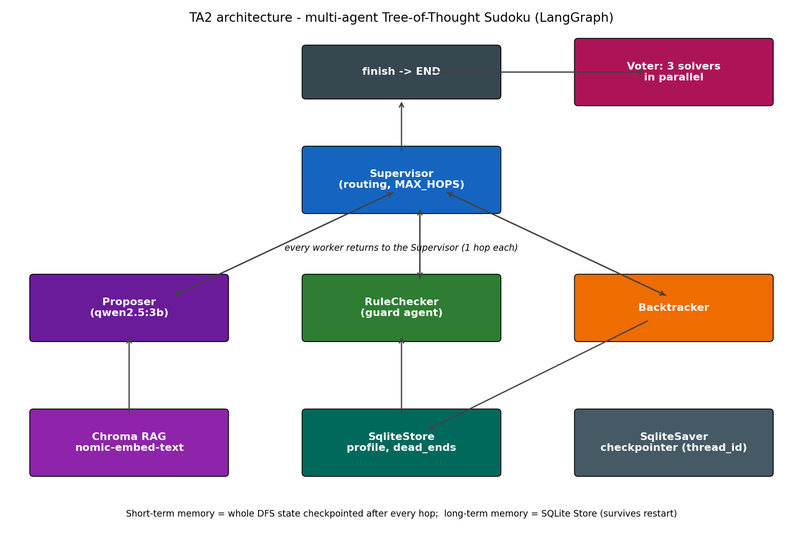

# Multi-Agent Tree-of-Thought Sudoku Solver

A small language model can't solve a Sudoku puzzle in one pass. This project
shows why, and fixes it with a set of agents that search, check, remember
and recover from errors. Everything runs locally: no paid APIs and no internet
access while the agents run.

| | |
|---|---|
| **Model** | `qwen2.5:3b` (chat) and `nomic-embed-text` (embeddings), served by [Ollama](https://ollama.com) |
| **Frameworks** | LangChain v1, LangGraph, Chroma (`langchain_chroma`), SQLite |
| **Course** | Agentic AI (TA2 project), MIT ADT University, Pune |

## Results at a glance

We ran the same five 4x4 puzzles through both versions of the project, using
the real model.

| Approach | Puzzles solved | LLM calls | Total time |
|---|---|---|---|
| TA1: one Chain-of-Thought prompt | **0 / 5** | 5 | – |
| TA1: Tree-of-Thought search | 5 / 5 | 58 | 269 s |
| TA2: multi-agent search | **5 / 5** | 61 | **200 s** |
| TA2: three solvers + majority vote | 5 / 5 | 186 | 384 s |

Three findings matter most:

- **Search beats a single prompt.** The one-shot prompt broke 7 to 11 Sudoku
  rules in every answer. Every search-based version solved every puzzle.
- **The rule checker is required for correctness, not only for security.**
  With the checker switched off, the model made 9 illegal moves on one
  puzzle with no attack at all. With the checker on, illegal moves dropped
  to 0, even under a prompt-injection attack.
- **Voting did not help here.** All five votes were unanimous, so voting
  never changed an answer, yet it cost about 3 times as many LLM calls.

The full numbers are in [`traces/eval_table.md`](traces/eval_table.md).

## How it works

Every step of the search goes through a **Supervisor**, which hands the work
to exactly one specialist agent and then takes control back.



| Agent | Job | Uses the LLM? |
|---|---|---|
| **Supervisor** | Decides which agent acts next. Stops after `MAX_HOPS = 120` steps. | No |
| **Proposer** | Suggests up to 3 digits for the next empty cell. | Yes |
| **RuleChecker** | Rejects any digit that breaks a row, column or box rule, and blocks prompt injection. It is the only agent that can prune a branch. | No |
| **Backtracker** | Undoes the last guess at a dead end and records the dead end in long-term memory. | No |
| **Voter** | Runs three independent solvers in parallel and keeps the majority answer. | No |

The search also uses three kinds of supporting state:

- **Short-term memory.** A LangGraph `SqliteSaver` checkpointer saves the
  whole search after every step, under a `thread_id`. A stopped search can
  resume, and a follow-up question on the same thread can read what happened.
- **Long-term memory.** A LangGraph `SqliteStore` keeps a user profile and a
  list of proven dead ends. Both survive a restart.
- **Retrieval (RAG).** Chroma indexes 10 short notes about Sudoku strategy.
  The Proposer reads a relevant note before it guesses, and the Q&A command
  answers only from the notes, replying "I don't know" when they don't contain
  the answer.

## Quick start

### Prerequisites

- Python 3.11 or later
- [Ollama](https://ollama.com), running locally
- About 2.5 GB of free disk space for the two models

### Install

```bash
ollama pull qwen2.5:3b
ollama pull nomic-embed-text
pip install -r ta2/requirements.txt
```

### Run everything

```bash
cd ta2
python run_all.py
```

This command seeds the memory and the search index, runs every demo, runs the
five-puzzle evaluation, and saves all console output in `traces/`. It takes
about 40 minutes on a laptop CPU. To run only the demos (about 10 minutes),
add `--demos`.

### Try single commands

Run these from the `ta2/` folder:

```bash
python seed_store.py                                       # set up memory and the search index (run once)
python main.py solve P1 --thread demo                      # solve puzzle P1 and print every step
python main.py ask demo "Which cell did you backtrack from first?"
python main.py solve P3 --thread t2 --max-hops 12          # stop early at the hop limit
python main.py solve P3 --thread t2 --resume               # continue the same search
python main.py solve P2 --fail-on 3,4                      # simulate two failed model calls
python main.py solve P1 --no-guard --no-memory             # switch off the rule checker
python main.py vote P1                                     # three solvers and a majority vote
python main.py rag "What is a naked single?" --k 1         # answer from the notes
```

Each solve also saves a picture of its search tree in `ta2/outputs/`. Green
nodes are the solution path, grey nodes were undone and red nodes were
pruned.

## Project structure

```
.
├── ta1/            Frozen TA1 baseline: single agent, CoT vs ToT (unchanged)
├── ta2/            TA2 extension: the multi-agent system
│   ├── main.py         Command-line entry point
│   ├── graph.py        LangGraph state graph and Supervisor routing
│   ├── agents.py       Proposer, RuleChecker, Backtracker and the role specs
│   ├── memory.py       Checkpointer, long-term store, profile, dead ends
│   ├── rag.py          Chroma index and grounded question answering
│   ├── vote.py         Three parallel solvers and the majority vote
│   ├── evaluate.py     Five-puzzle evaluation, TA1 vs TA2
│   ├── corpus/         The 10 notes used for retrieval
│   └── run_all.py      Runs every demo and the evaluation
├── traces/         Saved console output for every demo and test case
└── report/         Architecture diagram and the script that draws it
```

## What we learned

**What got better.** TA2 solved every puzzle and ran about 25% faster than
TA1's search, because each model reply is capped at 24 tokens. It also gained
abilities TA1 never had: it can resume a stopped search, remember dead ends
across restarts, recover from failed model calls and resist prompt injection.

**What did not get better.** TA2 used about the same number of LLM calls as
TA1, and TA1's search also solved all five puzzles. The gain is in
capability and reliability, not in raw cost.

**Limitations.**

- The 3B model is a weak proposer. It often suggests digits that already
  appear in the row, column or box, so the rule checker does most of the
  real work.
- Answers to follow-up questions are only partly reliable. In one test the
  model named the right cell but the wrong value, even though the saved
  record was correct.
- Dead-end memory matches exact boards only, so it does not carry over from
  one puzzle to another.
- Timings vary from run to run on a laptop CPU. LLM call counts are the
  stable measure.
